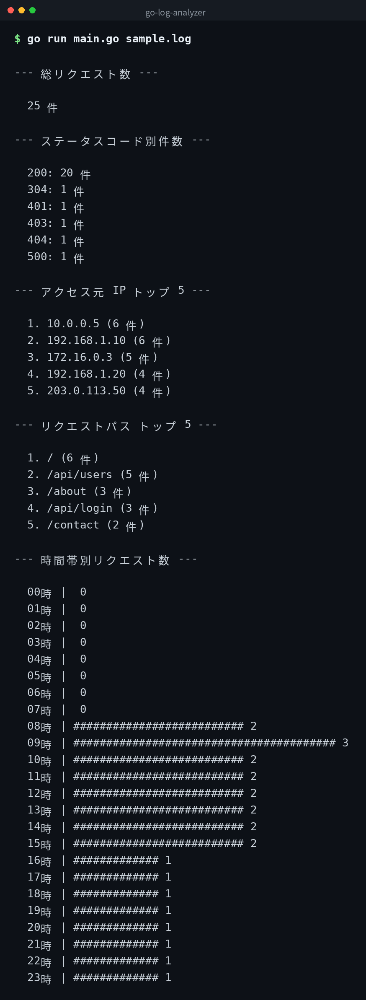

English | [日本語](ja/README.md) | [한국어](ko/README.md)


# go-log-analyzer

A Go CLI tool for analyzing Nginx access logs (combined format). It uses only the standard library with no external dependencies.

## Demo



*Actual output. The CLI interface is in Japanese.*

## Prerequisites

- Go 1.21 or later
- No external packages required (standard library only)

## Usage

### Run directly

```bash
go run main.go sample.log
```

### Build and run

```bash
go build -o log-analyzer main.go
./log-analyzer sample.log
```

## Output Example

Output when analyzing the bundled `sample.log` (the program's output is in Japanese):

```
--- 総リクエスト数 ---

  25 件

--- ステータスコード別件数 ---

  200: 20 件
  304: 1 件
  401: 1 件
  403: 1 件
  404: 1 件
  500: 1 件

--- アクセス元 IP トップ 5 ---

  1. 10.0.0.5 (6 件)
  2. 192.168.1.10 (6 件)
  3. 172.16.0.3 (5 件)
  4. 192.168.1.20 (4 件)
  5. 203.0.113.50 (4 件)

--- リクエストパス トップ 5 ---

  1. / (6 件)
  2. /api/users (5 件)
  3. /about (3 件)
  4. /api/login (3 件)
  5. /contact (2 件)

--- 時間帯別リクエスト数 ---

  08時 | ########################## 2
  09時 | ######################################## 3
  10時 | ########################## 2
  ...
  23時 | ############# 1
```

The counts in each section vary depending on the log content.

## Clone

```bash
git clone https://github.com/mivork/go-log-analyzer.git
```
