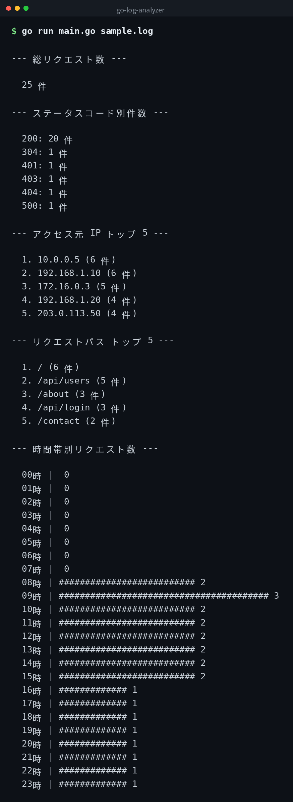

[English](../README.md) | 日本語 | [한국어](../ko/README.md)


# go-log-analyzer

Nginx のアクセスログ（combined 形式）を解析する Go 製 CLI ツールです。
標準ライブラリのみで動作し、外部依存はありません。

## デモ



## 必要環境

- Go 1.21 以上
- 外部パッケージ不要（標準ライブラリのみ使用）

## 使い方

### go run で実行

```bash
go run main.go sample.log
```

### ビルドして実行

```bash
go build -o log-analyzer main.go
./log-analyzer sample.log
```

## 出力例

`sample.log` を解析した場合の出力です。

```
--- 総リクエスト数 ---

  25 件

--- ステータスコード別件数 ---

  200: 20 件
  304: 1 件
  401: 1 件
  403: 1 件
  404: 1 件
  500: 1 件

--- アクセス元 IP トップ 5 ---

  1. 10.0.0.5 (6 件)
  2. 192.168.1.10 (6 件)
  3. 172.16.0.3 (5 件)
  4. 192.168.1.20 (4 件)
  5. 203.0.113.50 (4 件)

--- リクエストパス トップ 5 ---

  1. / (6 件)
  2. /api/users (5 件)
  3. /about (3 件)
  4. /api/login (3 件)
  5. /contact (2 件)

--- 時間帯別リクエスト数 ---

  08時 | ########################## 2
  09時 | ######################################## 3
  10時 | ########################## 2
  ...
  23時 | ############# 1
```

各セクションの件数はログの内容によって変動します。

## クローン

```bash
git clone https://github.com/mivork/go-log-analyzer.git
```
