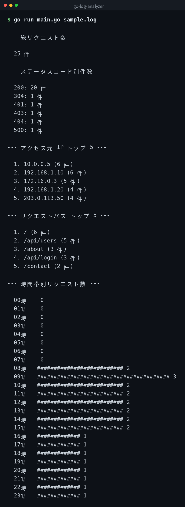

[English](../README.md) | [日本語](../ja/README.md) | 한국어


# go-log-analyzer

Nginx 액세스 로그(combined 형식)를 분석하는 Go CLI 도구입니다. 표준 라이브러리만 사용하며 외부 의존성이 없습니다.

## 데모



*실제 출력입니다. CLI 인터페이스는 일본어입니다.*

## 필요 환경

- Go 1.21 이상
- 외부 패키지 불필요 (표준 라이브러리만 사용)

## 사용법

### go run으로 실행

```bash
go run main.go sample.log
```

### 빌드 후 실행

```bash
go build -o log-analyzer main.go
./log-analyzer sample.log
```

## 출력 예시

번들된 `sample.log`를 분석한 출력입니다(프로그램 출력은 일본어입니다).

```
--- 総リクエスト数 ---

  25 件

--- ステータスコード別件数 ---

  200: 20 件
  304: 1 件
  401: 1 件
  403: 1 件
  404: 1 件
  500: 1 件

--- アクセス元 IP トップ 5 ---

  1. 10.0.0.5 (6 件)
  2. 192.168.1.10 (6 件)
  3. 172.16.0.3 (5 件)
  4. 192.168.1.20 (4 件)
  5. 203.0.113.50 (4 件)

--- リクエストパス トップ 5 ---

  1. / (6 件)
  2. /api/users (5 件)
  3. /about (3 件)
  4. /api/login (3 件)
  5. /contact (2 件)

--- 時間帯別リクエスト数 ---

  08時 | ########################## 2
  09時 | ######################################## 3
  10時 | ########################## 2
  ...
  23時 | ############# 1
```

각 섹션의 건수는 로그 내용에 따라 달라집니다.

## 클론

```bash
git clone https://github.com/mivork/go-log-analyzer.git
```
